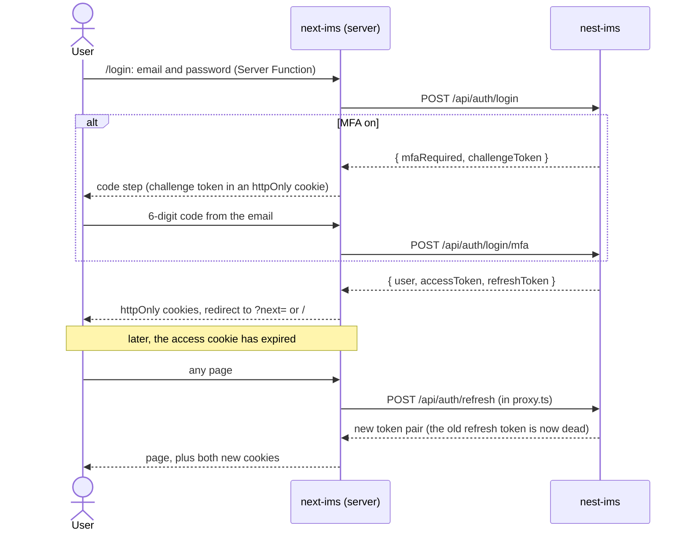

# next-ims

Responsive web UI for the IMS (inventory management system). It is a Next.js 16 app that talks to the [nest-ims](../nest-ims) API over HTTP; it has no database of its own.

Status: project scaffold. Docker development setup, code-quality tooling, PR automation, the theme, the app shell and sign-in are in place. Module pages are placeholders.

## 1. Running it (development)

Everything runs in Docker. You need Docker with Compose v2.

1. Start the API: in `../nest-ims`, run `docker compose up -d`. It serves `http://localhost:3001/api`. In its `.env`, set:
   - `CORS_ORIGINS=http://localhost:3000`, so the browser may call the API from this app.
   - `APP_URL=http://localhost:3000`, so invitation emails link to this app.
2. Here: `cp .env.example .env`, then `docker compose up -d app`.
3. Open http://localhost:3000. Edits on the host reload the page (Fast Refresh).

| Command | What it does |
| --- | --- |
| `docker compose up -d app` | Installs dependencies and runs `next dev` on port 3000 |
| `docker compose logs -f app` | Follow the dev server output |
| `docker compose exec app npm run lint` | ESLint, fails on warnings |
| `docker compose exec app npm run format` | Prettier, also sorts Tailwind classes |
| `docker compose exec app npm run typecheck` | `tsc --noEmit` |
| `docker compose exec app npm install <pkg>` | Add a dependency (then `npm install` on the host for the editor) |
| `docker compose down -v` | Stop and drop the container's `node_modules` and `.next` |

### How the container is set up

- Image `node:24-alpine`, the repo bind-mounted at `/app`.
- `node_modules` and `.next` are Docker volumes, not the host folders. The container needs Alpine builds of native packages (SWC, Tailwind, lightningcss), and keeping them in volumes means the container never writes root-owned files into the repo. The host's `node_modules` is only for the editor.
- On Docker Desktop (macOS, Windows) file events cross a VM and Fast Refresh can be slow; native Linux has no such delay.

## 2. Talking to the API

| Variable | Used by | Value in development |
| --- | --- | --- |
| `NEXT_PUBLIC_API_URL` | Code that runs in the browser | `http://localhost:3001/api` |
| `API_URL` | Server-side code (Server Components, Server Functions, Route Handlers) | `http://host.docker.internal:3001/api`, set by `docker-compose.yml` |
| `APP_LOGO_URL` | Company logo on the sign-in page and in the sidebar (optional) | `/logo.svg`, a placeholder in `public/` |

Two URLs are needed because server-side code runs inside the container, where `localhost` is the container itself; `host.docker.internal` reaches the API published on the host. `NEXT_PUBLIC_*` values are baked into the browser bundle at build time, so they must never hold secrets and a change needs a rebuild.

The API contract the UI relies on (auth, error shape, status codes, language) is summarised in `CLAUDE.md`. Invitation emails from the API link to `/set-password?token=...` on this app, so that route must keep its path.

All API calls go through `lib/api.ts`, from server code only. Each call passes on the user's `Accept-Language` (the API translates its messages) and `X-Forwarded-For`. The API rate-limits by client IP (login 5 and refresh 10 per minute), and every call reaches it from this server, so **nest-ims must have `TRUST_PROXY` set to count this app as a proxy hop** (plus any load balancer in front of the API). Otherwise all users share one IP and lock each other out. In production, put a reverse proxy in front of this app that appends the client IP to `X-Forwarded-For`; Next.js only fills the header when it is missing, so without one a client could send a fake IP.

**The logo** (`APP_LOGO_URL`) is a path under `public/` or a full URL. The browser loads it directly, not through the Next.js image optimizer, so a URL that only serves this app's domain (such as a restricted Azure Blob URL) still works. Static pages read it at build time, so a new value needs a rebuild. The API will later supply the logo per company.

### Sign-in and session

There is no sign-up: admins add users from user management (or an Excel import), and users set their first password from the invitation email.

- **Tokens never reach browser JavaScript.** They live in `httpOnly`, `SameSite=Lax` cookies (`Secure` in production): `ims_access` expires 30 seconds before its token, `ims_refresh` with its token, and `ims_mfa` holds the code-step challenge.
- **`proxy.ts`** sends visitors without a session to `/login?next=<path>` (only `/login` and `/set-password` are public). When the access cookie has expired, it refreshes before the page renders and passes the new token to that same render. It only checks cookies; the API still authorizes every call.
- **Refresh tokens rotate on every use**, so parallel requests (a page plus its prefetches) must not each refresh. Requests carrying the same refresh token share one call, and its result is kept for a minute. This works within one Node process; with several app instances, route each session to one instance.
- **The shell loads the user** from `GET /api/auth/me` behind a `Suspense` boundary, so the rest of the page is still prerendered. A 401 sends the user to `/login`; if the API is down, the account drawer says so and still offers sign-out.
- **Sign-out** calls `POST /api/auth/logout` (revokes the refresh token) and deletes the cookies.
- **Errors** from the API are shown as sent (already translated): field errors under their input, others above the form. A refresh the API rejects deletes the cookie and goes to sign-in; if the API cannot be reached, the cookie is kept for the next try.

## 3. Theme and layout

Site staff use the app on phones (including scanning barcodes with the camera), so screens are built for phones first and widened for tablets and desktops.

- **Palette**: slate neutrals with an indigo primary. Status colours (success, warning, danger, info) are kept apart from the primary, so a stock state never looks like a button. All text pairs meet WCAG AA (4.5:1), and input borders meet 3:1, in both modes.
- **Tokens** live in `app/globals.css` and become Tailwind colours: `background`, `surface`, `surface-muted`, `foreground`, `muted`, `border`, `input`, `primary`, `primary-foreground`, `ring`, `success`, `warning`, `danger`, `danger-foreground`, `info`. Use `bg-surface`, `text-muted`, `bg-success/10` and so on rather than raw palette colours, so a screen works in both modes without `dark:` classes.
- **Light, dark and system**: the header toggle (`components/theme-toggle.tsx`) stores an explicit choice in `localStorage` (`ims-theme`; nothing stored means follow the OS). An inline script in the root layout applies it as `data-theme` on `<html>` before the first paint, so there is no flash and the page stays statically rendered. The `dark:` variant follows the same rule. The theme is not secret, so `localStorage` is fine here (auth tokens never go there).
- **Responsive rules**: unprefixed classes are the phone layout; tap targets are at least 44px; inputs are at least 16px so iOS does not zoom on focus; wide tables become cards below `md`; the mobile browser bar takes the background colour (`viewport.themeColor` follows the OS; the theme toggle overrides it when the user picks Light or Dark).
- **Shared pieces**: `components/status-badge.tsx` (stock and record states), `components/avatar.tsx` (initials, since the API sends `avatarUrl: null` without a photo), `components/drawer.tsx` (side panel), `components/logo.tsx` (company logo), icons from `lucide-react`.

### App shell

Every signed-in screen sits in the `app/(app)` route group, whose layout draws the shell; the sign-in page lives outside it. The modules and their section tabs are one list in `lib/navigation.ts`; add a module there and both the sidebar and the top bar pick it up.

| Module | Route | Section tabs |
| --- | --- | --- |
| Dashboard | `/` | none |
| Inventory | `/inventory` | Items, Products (`/inventory/products`), Categories (`/inventory/categories`) |
| Sites | `/sites` | none |
| People | `/people` | Users, Invitations (`/people/invitations`), Roles (`/people/roles`) |
| Audit log | `/audit` | none |

`/login` is outside the group (route group `app/(auth)`), with only the logo, the form and the theme toggle.

`/profile` and `/settings` hang off the account panel.

- **Large screens (`lg`, 1024px and up)**: a fixed left sidebar lists the modules. The top bar shows the current module's name and section tabs on the left, and the theme toggle and avatar on the right.
- **Phones and tablets**: the top bar holds a menu button (left drawer with the modules), the module name, and the avatar (right drawer with the user's details, profile, settings, theme and sign out). The section tabs move to a strip under the top bar that scrolls sideways when they do not fit.
- **The avatar opens the same account drawer at every size**, so user actions live in one place.
- **Drawers are native modal `<dialog>`s**: focus stays inside, Esc closes them and focus returns to the button that opened them. Tapping the backdrop or a link closes them too, and the page behind does not scroll.
- **The active module and tab are found from the URL** (longest matching path, so `/inventory/products` selects Products, not Items). These parts call `usePathname`, so the layout wraps them in `Suspense`: under Cache Components, a page with an unknown dynamic segment (such as a future `/inventory/[id]`) would otherwise fail to prerender.
- **Still to do**: hiding modules the user's role cannot use (for example the audit log is for admins), the email verification screen (the API answers 403 `Email is not verified` until then), and `/set-password` for invitations.

## 4. Code quality and automation

- **Prettier + ESLint** (`eslint-config-next` core web vitals and TypeScript rules, `eslint-config-prettier` so they do not fight).
- **Claude Code hooks** (`.claude/settings.json`):
  - after every edit of a code or CSS file: format and lint inside the container, and hand errors back to Claude;
  - at the end of each prompt: list comments in changed files so needless ones get trimmed;
  - at the end of each prompt: ask for a README update when routes, config, Docker, CI, env or dependencies changed.
- **`pr-description` skill** (`.claude/skills/pr-description`): the single source for PR description rules and template (summary, business changes, screens, backend dependency, release notes). Use it on request locally; the CI *PR description* job loads it too. CI uses the base branch's copy of `.claude/` and `CLAUDE.md`, so changes to them apply from the PR after they merge.
- **GitHub Actions** (`.github/workflows/claude-code-review.yml`), on every non-draft PR:
  1. *PR description*: rewrites a bot-owned block in the PR body (summary, business changes, screens, backend dependency, release notes). Text outside the block is kept.
  2. *Claude review*: posts a review comment with a verdict; the check fails (as a warning, not a merge block) unless it is ✅.

  Both need the repository secret `CLAUDE_CODE_OAUTH_TOKEN`. Docs-only, `.github/`, `.claude/` and lockfile-only changes do not trigger them.

## 5. Production

Not set up yet: no production image, no image publishing and no deployment pipeline.
